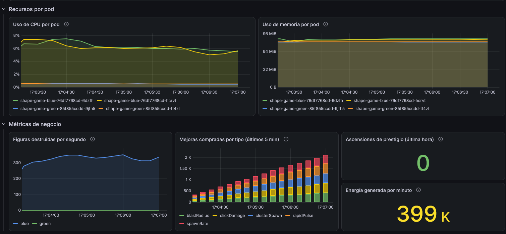

# Shape Popper: DevOps y DevSecOps sobre Kubernetes

Juego web incremental (*clicker*) llevado a un flujo DevOps y DevSecOps completo: contenedores con **Docker**, despliegue **Blue/Green** en **Kubernetes** (minikube) con **Helm**, persistencia en **Redis**, pipeline CI/CD con **Jenkins**, monitoreo con **Prometheus** y **Grafana**, y seguridad integrada con **Semgrep**, **Snyk**, **Trivy**, **Kyverno** y **Falco**.

Participantes: Santiago Aurrecochea

---

## Índice

| Apartado del reporte | Sección |
| :--- | :--- |
| a. Descripción general | [Descripción general](#descripción-general) |
| b. Arquitectura final | [Arquitectura](#arquitectura) |
| Guía paso a paso (comandos y resultados) | [Guía paso a paso](#guía-paso-a-paso) |
| 1. Contenerización | [Contenedores e imágenes](#1-contenedores-e-imágenes-docker-trivy-dive) |
| 2. Kubernetes + Helm | [Despliegue con Helm](#2-despliegue-con-helm) |
| c. Pipeline implementado | [Pipeline CI/CD](#3-pipeline-cicd-jenkins) |
| d. Métricas y dashboard | [Monitoreo](#4-monitoreo-y-observabilidad-prometheus--grafana) |
| e. Resultados de seguridad | [Seguridad](#5-seguridad-devsecops) |
| f. Problemas y soluciones | [Problemas encontrados y soluciones adoptadas](#problemas-encontrados-y-soluciones-adoptadas) |
| g. Conclusiones y mejoras | [Conclusiones y oportunidades de mejora](#conclusiones-y-oportunidades-de-mejora) |
| Ayuda | [Solución de problemas](#solución-de-problemas) · [Correspondencia con el enunciado](#correspondencia-con-el-enunciado) |

---

## Descripción general

El proyecto separa el frontend y la lógica de juego (pods sin estado) de la base de datos (Redis con almacenamiento persistente). Esto permite actualizar la aplicación entre versiones o volver atrás al instante, sin interrumpir la partida ni perder el progreso del jugador.

Sobre esa base se aplicó todo el ciclo DevOps: las imágenes se construyen y analizan automáticamente, el pipeline revisa el código y las dependencias antes de construir, Kubernetes rechaza cualquier despliegue inseguro, Falco vigila lo que pasa dentro de los contenedores y Grafana muestra el tráfico y las métricas de negocio en tiempo real.

### Diferencias entre versiones (Blue vs. Green)

| Característica | Versión Blue (`v1.0.0`) | Versión Green (`v2.0.0`) |
| :--- | :--- | :--- |
| **Rol en el ciclo** | Versión inicial en producción. | Nueva versión / actualización. |
| **Mecánica principal** | Clics en polígonos, mejoras de radio AoE, cadencia y daño. | Misma base + nuevas mecánicas avanzadas. |
| **Sistema de prestigio** | Deshabilitado (pestaña bloqueada, API 403). | **Ascensión** habilitada: reinicia la partida a cambio de **Fragmentos Prismáticos** con multiplicador global permanente. |
| **Torretas defensivas** | No disponibles en la tienda. | Desbloqueables tras el primer prestigio (disparan láseres automáticos desde las esquinas). |

---

## Arquitectura

### Vista completa

```
  Desarrollador ── git push ──► GitHub (repositorio)          ghcr.io/santmacedonio/shape-game
                                      │                                  ▲
                                      │ Jenkins revisa el repo           │ push de la imagen
                                      ▼ cada 5 minutos                   │ (paquete público)
          ┌────────── Jenkins (contenedor Docker, fuera del cluster) ────┴──────────────┐
          │ 1 Checkout · 2 Semgrep + Snyk · 3 npm ci + tests · 4 docker build + Trivy   │
          │ 5 Deploy con Helm (Blue/Green, smoke test, helm test, rollback automático)  │
          └──────────────────────────────────┬──────────────────────────────────────────┘
                                             │ helm upgrade (ServiceAccount con permisos mínimos)
  ┌──────────────────────────────── minikube · Kubernetes 1.37 ─┼─────────────────────────────────┐
  │                                                             ▼                                 │
  │  ingress-nginx       default (prod)                         shape-dev (dev)                   │
  │  Ingress ──────────► Service shape-game ─► blue | green     misma Chart, values-dev.yaml      │
  │  shape-game.local    (release Helm)          └─► Redis + PVC                                  │
  │                             ▲ /metrics de cada pod                                            │
  │  monitoring          Prometheus ─────────────► Grafana (dashboard)                            │
  │  kyverno             4 políticas: valida cada pod antes de crearlo (rechaza lo inseguro)      │
  │  falco               sonda eBPF: observa las llamadas al sistema de todos los contenedores    │
  └───────────────────────────────────────────────────────────────────────────────────────────────┘
```

### La aplicación (release de Helm)

Todo lo que está dentro del recuadro lo despliega la **Helm Chart** ([`helm-chart/`](helm-chart/)) como una release (en prod: `shape-game`, namespace `default`).

```
        navegador ── http://shape-game.local (Ingress) ── o ── NodePort :30080
                                       │
   ┌───────────────────────────────────┼────────────────────────────────────┐
   │ release Helm "shape-game"         ▼                                    │
   │                  ┌──────────────────────────────┐                      │
   │                  │ Service shape-game           │  selector: version = │
   │                  │ (app.activeColor)            │  blue | green        │
   │                  └──────────────┬───────────────┘                      │
   │                    (switch)     │                                      │
   │              ┌──────────────────┴───────────────┐                      │
   │              ▼                                  ▼                      │
   │   ┌────────────────────┐            ┌────────────────────┐             │
   │   │ shape-game-blue    │            │ shape-game-green   │ Deployments │
   │   │ shape-game:v1      │            │ shape-game:v2      │ Express:    │
   │   └─────────┬──────────┘            └─────────┬──────────┘ API + web   │
   │             └──────────────┬───────────────────┘   ▲ ConfigMap         │
   │                            ▼                            shape-game-config
   │                 ┌──────────────────────┐                               │
   │                 │ shape-game-redis     │  ClusterIP :6379              │
   │                 │ shape-redis:1.0.1    │  ▲ ConfigMap (redis.conf)     │
   │                 └──────────┬───────────┘                               │
   │                            ▼                                           │
   │                 PVC shape-game-redis-data (1Gi, AOF)                   │
   └────────────────────────────────────────────────────────────────────────┘
```

### Componentes y contenedores

| Componente | Imagen | Dockerfile | Descripción |
| :--- | :--- | :--- | :--- |
| App (backend + frontend) | `shape-game:v1` / `shape-game:v2` | [`Dockerfile`](Dockerfile) | Node.js 22 + Express. Sirve la API (`/api/*`), las probes (`/healthz`, `/readyz`), las métricas (`/metrics`) y el frontend estático (`src/public`). Multi-stage, usuario `node`. |
| Redis | `shape-redis:1.0.1` | [`redis/Dockerfile`](redis/Dockerfile) | Redis 7.4 con [`redis.conf`](redis/redis.conf) propio (AOF). Multi-stage aplanado en una capa, usuario `redis`. |
| Jenkins (CI/CD) | `shape-jenkins:1.0.0` | [`jenkins/Dockerfile`](jenkins/Dockerfile) | Jenkins LTS con Node.js, Docker CLI, kubectl, Helm, Trivy, Snyk y Semgrep. Corre fuera del cluster. |

Prometheus, Grafana, Kyverno y Falco usan sus imágenes o charts oficiales con versión fija y sin modificaciones: son herramientas de plataforma, no componentes de la aplicación. El generador de tráfico reutiliza la imagen de la app, que trae `sh` y `wget`.

El frontend no tiene un contenedor propio porque son archivos estáticos que sirve el mismo proceso Express. Así, cada versión (blue o green) despliega juntos el frontend y el backend que le corresponden.

---

## Guía paso a paso

### Prerrequisitos

Versiones probadas:

| Herramienta | Versión |
| :--- | :--- |
| Docker Desktop (Docker Engine) | 28.5 |
| Minikube | 1.39 (Kubernetes 1.37) |
| kubectl | 1.34+ |
| Helm | 4.3 (los scripts usan opciones de Helm 4) |
| Node.js *(opcional, para correr los tests y Snyk fuera de Jenkins)* | 22+ |
| Trivy, Dive, KubeLinter, Semgrep | No hace falta instalarlos: si no están, los scripts usan sus contenedores oficiales con versión fija |
| Jenkins | No hace falta instalarlo: corre en un contenedor con todas sus herramientas |
| Cuenta de [Snyk](https://snyk.io) *(gratuita)* | Para el análisis de dependencias (token en `.env.jenkins`) |

Todos los scripts están en [`scripts/`](scripts/) en dos versiones: `.sh` (bash: Linux, macOS, WSL o Git Bash) y `.ps1` (Windows PowerShell). Se pueden ejecutar desde cualquier carpeta.

| Script | Qué hace |
| :--- | :--- |
| `setup` | **Levanta todo de cero:** minikube + Ingress, Kyverno y Falco, imágenes, app (prod y dev), Prometheus + Grafana y Jenkins |
| `generate-traffic` | Simula jugadores contra la app para poblar el dashboard |
| `cleanup` | **Borra todo** lo que el proyecto creó en el cluster (`--all`: también Jenkins y el Ingress) |
| `build` · `deploy` · `deploy-monitoring` · `install-security` · `jenkins-up` / `jenkins-down` | Cada paso por separado (los usa `setup`) |
| `switch-to-green` / `switch-to-blue` | Cambio de tráfico Blue/Green |
| `scan` · `security-scan` · `test-policies` · `test-falco` | Análisis de imágenes y de seguridad, con sus reportes en `reports/` |

### Paso 1: levantar todo

```bash
./scripts/setup.sh --all          # Windows: .\scripts\setup.ps1 -All
```

Sin opciones levanta solo prod. `--with-dev` agrega el entorno de desarrollo, `--with-jenkins` agrega Jenkins y `--all` hace las dos cosas. La primera vez tarda entre 5 y 15 minutos, según cuánto haya que descargar. Para Jenkins, antes completá `SNYK_TOKEN` en `.env.jenkins` (ver [Pipeline](#levantar-jenkins-y-correr-el-pipeline)).

**Resultado obtenido** (extracto):

```
#  [3/7] Operadores de seguridad: Kyverno + Falco
[OK] SUCCESS: security tools installed
#  [4/7] Imágenes Docker
[OK] SUCCESS: images built
#  [5/7] App con Helm
Phase:          Succeeded
OK: servicio accesible, color activo blue, Redis conectado
[OK] SUCCESS: shape-game deployed in namespace default
#  [6/7] Monitoreo: Prometheus + Grafana
[OK] SUCCESS: monitoring stack is running
```

### Paso 2: verificar el despliegue

```bash
helm list -A
kubectl get pods -l app.kubernetes.io/instance=shape-game
helm test shape-game --logs
```

**Resultado obtenido:**

```
NAME            NAMESPACE   REVISION  STATUS    CHART             APP VERSION
falco           falco       3         deployed  falco-9.2.2       0.45.2
kyverno         kyverno     2         deployed  kyverno-3.10.0    v1.20.0
shape-game      default     12        deployed  shape-game-1.0.0  v1.0.0
shape-game-dev  shape-dev   18        deployed  shape-game-1.0.0  v1.0.0

NAME                                READY   STATUS    RESTARTS   AGE
shape-game-blue-76df7768cd-6dzfh    1/1     Running   0          26s
shape-game-blue-76df7768cd-hcrvt    1/1     Running   0          35s
shape-game-green-85f855ccdd-9jfh5   1/1     Running   0          28s
shape-game-green-85f855ccdd-tt4zl   1/1     Running   0          35s
shape-game-redis-6dcd96c6-z4wnp     1/1     Running   0          33s

GET http://shape-game:80/readyz (intento 1): {"status":"ready",...,"color":"blue","version":"v1.0.0","redis":"connected"}
GET http://shape-game:80/ -> 200 (frontend OK)
OK: servicio accesible, color activo blue, Redis conectado
```

Los contenedores **no** corren como root:

```bash
$ kubectl exec deploy/shape-game-blue -- id
uid=1000(node) gid=1000(node) groups=1000(node)
$ kubectl exec deploy/shape-game-redis -- id
uid=999(redis) gid=1000(redis) groups=1000(redis)
```

### Paso 3: jugar y hacer el switch Blue/Green

```bash
minikube service shape-game                 # abre el juego (prod, NodePort 30080)
./scripts/switch-to-green.sh                # helm upgrade que solo cambia app.activeColor
./scripts/switch-to-blue.sh                 # o "helm rollback shape-game"
```

Al refrescar la página después del switch, la interfaz cambia al tema verde y desbloquea el prestigio **sin perder los puntos acumulados**, porque el estado vive en Redis.

### Paso 4: generar tráfico y ver el dashboard

```bash
./scripts/generate-traffic.sh 300 8         # 300 segundos, 8 jugadores simulados
minikube service grafana -n monitoring      # dashboard "Shape Popper - Blue/Green"
```

Mientras el generador corre, el dashboard muestra RPS, latencia, CPU y memoria por pod y las métricas de negocio. Con `switch-to-green` en el medio se ve el tráfico pasar de la serie blue a la green. Ver [Monitoreo](#4-monitoreo-y-observabilidad-prometheus--grafana).

### Paso 5: generar la evidencia de seguridad

```bash
./scripts/scan.sh             # Trivy + Dive de cada imagen       -> reports/scans/, reports/image-analysis.md
./scripts/security-scan.sh    # npm audit, Snyk, Semgrep, Trivy, KubeLinter -> reports/
./scripts/test-policies.sh    # manifiestos que violan las políticas -> reports/kyverno-validation.log
./scripts/test-falco.sh       # acciones sospechosas en un pod       -> reports/falco-event.log
```

**Resultado obtenido:**

```
[OK] Reports generated:
  reports/npm-audit.txt        found 0 vulnerabilities
  reports/snyk-report.txt      Vulnerabilidades: critical=0  high=0  medium=0  low=0
  reports/semgrep-report.txt   Ran 212 rules on 92 files: 1 finding. | 3/3: ✓ All tests passed
  reports/trivyreport.txt      own images: 0 target(s) with findings | third-party: 22 HIGH (documented)
  reports/kubelinter.txt       No lint errors found!

01-latest-tag.yaml                  esperado=RECHAZADO resultado=RECHAZADO [OK]
02-no-resources.yaml                esperado=RECHAZADO resultado=RECHAZADO [OK]
03-run-as-root.yaml                 esperado=RECHAZADO resultado=RECHAZADO [OK]
04-compliant.yaml                   esperado=ACEPTADO  resultado=ACEPTADO  [OK]
05-privilege-escalation.yaml        esperado=RECHAZADO resultado=RECHAZADO [OK]
[OK] All policies behave as expected -> reports/kyverno-validation.log
```

Los resultados y su análisis están en [Seguridad](#5-seguridad-devsecops).

### Paso 6: correr el pipeline

Con Jenkins levantado (`setup --all` o `jenkins-up`), el pipeline corre solo:

1. Un `git push` a una rama `feature/...` dispara su build en hasta 5 minutos: análisis, tests, imagen y despliegue en **dev**.
2. Un Pull Request de esa rama a `main`, una vez mezclado, dispara el build de `main`: publica la imagen en ghcr.io y despliega en **prod** con Blue/Green.

Los builds se siguen en <http://localhost:8080> (usuario `admin`). El detalle está en [Pipeline CI/CD](#3-pipeline-cicd-jenkins).

### Paso 7: borrar todo

```bash
./scripts/cleanup.sh          # todo lo del cluster (app, datos de Redis, monitoreo, Kyverno, Falco)
./scripts/cleanup.sh --all    # además Jenkins (contenedor, historial y permisos) y el addon de Ingress
minikube delete               # opcional: borra el cluster entero
```

---

## 1. Contenedores e imágenes (Docker, Trivy, Dive)

Cada componente tiene su Dockerfile. Las imágenes usan **versiones exactas** (nunca `latest`), corren con **usuarios sin privilegios** y son **multi-stage**:

- **App:** la etapa `deps` instala las dependencias con npm. La imagen final parte de un Alpine limpio y copia solo el binario de Node y `node_modules`: npm no llega a producción.
- **Redis:** una etapa aplica los parches de seguridad de Alpine (`apk upgrade`) y la imagen final copia ese sistema ya actualizado sobre `FROM scratch`, en una sola capa sin paquetes duplicados.

```bash
./scripts/build.sh     # build sin caché (--pull --no-cache) y carga en minikube
./scripts/scan.sh      # Trivy (vulnerabilidades) + Dive en modo CI (eficiencia de capas)
```

**Resultado obtenido** ([`reports/scans/summary.txt`](reports/scans/summary.txt)):

| Imagen | Tamaño | Capas | Vulnerabilidades (Trivy) | Eficiencia (Dive) | Dive CI |
| :--- | :--- | :--- | :--- | :--- | :--- |
| `shape-game:v1` / `v2` | 218 MB (54 MB comprimida) | 7 | **0** | 96.0 % | PASS |
| `shape-redis:1.0.1` | 57.7 MB (15 MB comprimida) | 3 | **0** | 100 % | PASS |

El reporte completo (tamaño, capas, comparación antes/después, historial y observaciones de optimización) está en **[`reports/image-analysis.md`](reports/image-analysis.md)**. Para explorar las capas de forma interactiva: `dive shape-game:v1`, o sin instalar Dive, `docker run --rm -it -v /var/run/docker.sock:/var/run/docker.sock wagoodman/dive:v0.13.1 shape-game:v1`.

### Buenas prácticas aplicadas

- **Versiones exactas** en todas las imágenes base: `node:22.23.5-alpine3.24`, `alpine:3.24.4` y `redis:7.4.12-alpine3.22`.
- **Multi-stage build** en la app y en Redis.
- **Usuarios no root**: `node` (uid 1000) y `redis` (uid 999), en el Dockerfile (`USER`) y en Kubernetes (`securityContext.runAsNonRoot`).
- **Builds sin caché** (`--pull --no-cache`), para que el `apk upgrade` realmente traiga los últimos parches.
- **Hardening en Kubernetes**: `readOnlyRootFilesystem`, `allowPrivilegeEscalation: false`, `capabilities.drop: [ALL]` y `seccompProfile: RuntimeDefault`.
- **Builds reproducibles**: `npm ci` con `package-lock.json`, `.dockerignore` y `.gitattributes`. Este último fuerza saltos de línea LF en los `.sh`, para que funcionen en Linux aunque el repo se clone en Windows.

---

## 2. Despliegue con Helm

La Chart [`helm-chart/`](helm-chart/) despliega todo el proyecto: las dos versiones de la app y Redis. Prometheus, Grafana, Kyverno y Falco quedan afuera a propósito. Son herramientas de plataforma que se instalan una vez por cluster con sus propios scripts, no en cada despliegue de la app.

```
helm-chart/
├── Chart.yaml
├── values.yaml            # valores por defecto: alcanza con "helm install <nombre> ./helm-chart"
├── values-dev.yaml        # entorno de desarrollo
├── values-prod.yaml       # entorno de producción
└── templates/
    ├── _helpers.tpl       # nombres, etiquetas y securityContext comunes
    ├── NOTES.txt          # instrucciones que se muestran después de instalar
    ├── app-configmap.yaml     ├── redis-configmap.yaml   (redis.conf)
    ├── app-deployment.yaml    ├── redis-deployment.yaml
    ├── app-service.yaml       ├── redis-service.yaml
    ├── ingress.yaml           ├── redis-pvc.yaml
    └── tests/test-connection.yaml   # helm test
```

- **Un Deployment por color:** `app-deployment.yaml` recorre `app.versions` y genera un Deployment por cada versión habilitada.
- **El switch:** el Service apunta a `app.activeColor`. Si se pide un color que no existe o está deshabilitado, la Chart falla con un mensaje claro en vez de desplegar un Service sin pods.
- **Reinicio automático:** los Deployments llevan el *checksum* de su ConfigMap, así un cambio de configuración reinicia los pods con `helm upgrade`.
- **El PVC de Redis sobrevive al `uninstall`:** tiene `helm.sh/resource-policy: keep`, para no perder partidas por accidente. `cleanup` lo borra explícitamente.

### Parámetros principales (`values.yaml`)

| Parámetro | Por defecto | Descripción |
| :--- | :--- | :--- |
| `app.activeColor` | `blue` | Versión que recibe el tráfico (`blue` o `green`) |
| `app.port` | `3000` | Puerto del contenedor |
| `app.versions.<color>.enabled` / `.replicas` | `true` / `1` | Si se despliega esa versión y con cuántas réplicas |
| `app.versions.<color>.image.repository` / `.tag` | `shape-game` / `v1`, `v2` | Imagen de cada versión |
| `app.resources` | `50m`–`200m` CPU, `64Mi`–`256Mi` | Requests y limits de la app |
| `app.extraConfig` | `NODE_ENV: production` | Variables extra en el ConfigMap |
| `service.type` / `.port` / `.nodePort` | `NodePort` / `80` / `30080` | Exposición del Service |
| `ingress.enabled` / `.host` / `.className` | `false` / `shape-game.local` / `nginx` | Ingress |
| `redis.image.*`, `redis.resources`, `redis.maxmemory`, `redis.appendonly` | `shape-redis:1.0.1`, …, `200mb`, `true` | Redis |
| `redis.persistence.enabled` / `.size` | `true` / `1Gi` | PVC o `emptyDir` |
| `monitoring.scrape` | `true` | Anotaciones para Prometheus |
| `tests.enabled` | `true` | Pod de `helm test` |

Con los valores por defecto alcanza con el comando del enunciado:

```bash
helm install shape-game ./helm-chart
```

### Entornos

| | `values-dev.yaml` | `values-prod.yaml` |
| :--- | :--- | :--- |
| Release / namespace | `shape-game-dev` / `shape-dev` | `shape-game` / `default` |
| Réplicas por color | 1 | 2 |
| Recursos de la app | `25m`–`150m` CPU, `48Mi`–`128Mi` | `50m`–`200m` CPU, `64Mi`–`256Mi` |
| Acceso | NodePort `30081` | **Ingress** `shape-game.local` + NodePort `30080` |
| Redis | Sin PVC (`emptyDir`), sin AOF, `maxmemory 64mb` | PVC 1Gi, AOF, `maxmemory 200mb` |
| `NODE_ENV` | `development` | `production` |
| Métricas para Prometheus | No | Sí |

Los dos entornos pueden convivir en el cluster.

```bash
helm install shape-game ./helm-chart -f helm-chart/values-prod.yaml
helm install shape-game-dev ./helm-chart -f helm-chart/values-dev.yaml -n shape-dev --create-namespace
```

### Blue/Green y rollback con Helm

```bash
helm upgrade shape-game ./helm-chart --reset-then-reuse-values --set app.activeColor=green --wait
helm history shape-game      # cada switch queda como una revisión
helm rollback shape-game     # vuelve a la revisión anterior
```

`--reset-then-reuse-values` conserva los valores de la release (por ejemplo, los de `values-prod.yaml`) y solo cambia el color.

### Ingress

En producción la app se expone con un Ingress (host `shape-game.local`) a través del Ingress Controller de minikube:

```bash
minikube addons enable ingress
minikube tunnel            # en otra terminal; en Windows puede pedir permisos de administrador
```

Para abrir `http://shape-game.local` en el navegador, agregá `127.0.0.1 shape-game.local` al archivo `hosts` (`C:\Windows\System32\drivers\etc\hosts`). Para probarlo sin tunnel ni `hosts`:

```bash
kubectl port-forward -n ingress-nginx svc/ingress-nginx-controller 8088:80
curl -H "Host: shape-game.local" http://localhost:8088/api/version
```

El namespace `ingress-nginx` está excluido de las políticas de Kyverno: el addon de minikube no define `requests` ni `limits` y la política lo bloqueaba.

---

## 3. Pipeline CI/CD (Jenkins)

El [`Jenkinsfile`](Jenkinsfile) automatiza todo el camino desde un commit hasta el despliegue en Kubernetes. El entorno de destino lo decide la rama ([ver abajo](#ramas-y-entornos-cómo-llega-un-cambio-a-producción)):

```
 1. Checkout ─► 2. Seguridad del código ─────────► 3. Build y tests ─► 4. Imagen Docker ──────► 5. Deploy con Helm
    git clone      Semgrep (SAST)    ┐ en             npm ci              docker build             color inactivo ← imagen nueva
    tag de la      Snyk (dependencias)┘ paralelo      27 tests (JUnit)    Trivy (corta si CRITICAL)  smoke test de ese color
    imagen                                                                minikube o ghcr.io       switch del tráfico
                                                                                                    helm test (rollback si falla)
```

**Blue/Green en el pipeline:** la imagen nueva siempre va al color que **no** recibe tráfico. Se prueba ahí y recién después se le pasa el tráfico, así que los colores se alternan en cada despliegue (blue → green → blue…). El color activo no se toca durante todo el proceso: sigue atendiendo a los jugadores y es la versión a la que se vuelve si algo falla. En el pipeline, el color es solo una "ranura": la versión nueva usa el tag de la imagen como versión y tiene el prestigio activado, caiga en blue o en green. La tabla de [diferencias entre versiones](#diferencias-entre-versiones-blue-vs-green) describe la demo manual con `shape-game:v1` y `v2`.

**Compatibilidad de datos:** las dos versiones comparten Redis, así que cada una tiene que poder leer lo que escribe la otra **sin borrar lo que no usa**. Si no, volver atrás le haría perder datos a los jugadores. Por eso la versión sin prestigio conserva las torretas y los fragmentos aunque no los aplique (hay un test que lo verifica). Los cambios que rompen el formato de los datos se hacen en varios despliegues (*expand / contract*), para que nunca convivan dos versiones que no se entiendan.

Cada etapa escribe su propio log en Jenkins y sus reportes se archivan con el build (`reports/ci/`: `semgrep-report.txt`, `snyk.json`, `trivy.txt`; `reports/tests/junit.xml`). La imagen se etiqueta `versión-rama-build-commit` (por ejemplo `shape-game:1.0.0-main-3-cda567c`): nunca `latest`, y siempre se sabe de qué rama y de qué commit salió.

Extracto real del log de un build (el [#11](reports/jenkins/build-11-publicacion-ghcr.txt)):

```
[Snyk]      Vulnerabilidades: critical=0  high=0  medium=0  low=0
[Semgrep]   Ran 209 rules on 85 files: 0 findings.
[Tests]     ℹ tests 26  ℹ pass 26  ℹ fail 0
[Trivy]     + trivy image --quiet --scanners secret --exit-code 1 ghcr.io/santmacedonio/shape-game:1.0.0-11-9be4c1d
[Push]      Login Succeeded
            1.0.0-11-9be4c1d: digest: sha256:d7af97bd32a1... size: 856
[Deploy]    >>> Smoke test de los pods GREEN
            >>> helm test shape-game-dev
            OK: servicio accesible, color activo blue, Redis conectado
            >>> Despliegue OK
Finished: SUCCESS
```

### Cortes de seguridad

Si alguna herramienta encuentra un problema crítico, el pipeline **se detiene en esa etapa**, explica el motivo y las etapas siguientes quedan como *skipped*. Así, nada vulnerable se construye, se publica ni se despliega.

| Etapa | Herramienta | Se detiene si… |
| :--- | :--- | :--- |
| 2 | Semgrep ([`ci/semgrep-gate.js`](ci/semgrep-gate.js)) | hay hallazgos de severidad `ERROR` en el código |
| 2 | Snyk ([`ci/snyk-summary.js`](ci/snyk-summary.js)) | alguna dependencia npm tiene una vulnerabilidad `critical` (o Snyk no puede analizar, por ejemplo por falta de token) |
| 3 | `node --test` | falla algún test |
| 4 | Trivy | la imagen tiene vulnerabilidades `CRITICAL` o **cualquier secreto** (claves, tokens, contraseñas), sin importar su severidad. Se revisa antes de publicar porque el paquete de ghcr.io es público |
| 5 | [`ci/deploy.sh`](ci/deploy.sh) | el color nuevo no responde, no se conecta a Redis o falla `helm test`. En ese caso hace además `helm rollback` a la revisión anterior |

### Ramas y entornos: cómo llega un cambio a producción

El job `shape-game` es un **Multibranch Pipeline**: Jenkins descubre solo las ramas del repositorio y crea un sub-job por cada una que tenga `Jenkinsfile`. **La rama decide el entorno**, así que no hay forma de mandar a prod código que no esté en `main`:

```
 rama feature/...  ── git push ──►  CI completo + despliegue en DEV (shape-dev)
        │
   Pull Request en GitHub (revisión del cambio)
        ▼
 rama main         ── merge ─────►  CI completo + imagen publicada en ghcr.io + despliegue en PROD (Blue/Green)
```

| Rama | Análisis, tests e imagen | Publica en ghcr.io | Despliega en |
| :--- | :--- | :--- | :--- |
| `main` | Sí | Siempre | **prod** (release `shape-game`, namespace `default`, Blue/Green) |
| `feature/*` | Sí | Solo si se marca `PUBLISH_IMAGE` | **dev** (release `shape-game-dev`, namespace `shape-dev`) |
| Otras | No se construyen | — | — |

Jenkins revisa el repositorio cada 5 minutos y lanza el build de cada rama que tenga commits nuevos. Se usa *polling* porque GitHub no puede enviarle un webhook a un Jenkins que corre en una máquina local. **El merge a `main` es la aprobación para producción:** se hace después de revisar el Pull Request y de ver el cambio funcionando en dev. Además, la etapa de despliegue verifica la rama y se niega a desplegar en prod si no es `main`, aunque alguien edite el `Jenkinsfile` en otra rama.

### Levantar Jenkins y correr el pipeline

Jenkins corre en un contenedor (`shape-jenkins`) armado con [`jenkins/Dockerfile`](jenkins/Dockerfile). La imagen trae Node.js, Docker CLI, kubectl, Helm, Trivy, Snyk y Semgrep con versiones fijas. Toda la configuración está en [`jenkins/casc.yaml`](jenkins/casc.yaml) (*Jenkins Configuration as Code*): el usuario, las credenciales y el job. No hay que configurar nada a mano en la interfaz.

1. Con Minikube encendido, ejecutar el script una vez. La primera vez crea `.env.jenkins` a partir de [`.env.jenkins.example`](.env.jenkins.example):
   ```powershell
   .\scripts\jenkins-up.ps1        # ./scripts/jenkins-up.sh
   ```
2. Completar en `.env.jenkins` el token de Snyk (`SNYK_TOKEN`, de snyk.io → *Account settings* → *Auth Token*) y, para publicar en ghcr.io, `GHCR_USER` y `GHCR_TOKEN` (un token *classic* de GitHub con permiso `write:packages`). Después, volver a ejecutar `jenkins-up`. Ese archivo tiene los secretos y **no se sube al repositorio**.
3. Entrar a <http://localhost:8080> con el usuario `admin` y la contraseña que muestra el script (también está en `.env.jenkins`).
4. En el job **shape-game** aparece una entrada por rama. Los builds se lanzan solos con cada *push*; para lanzar uno a mano: rama → *Build with Parameters*.

| Parámetro | Valores | Qué hace |
| :--- | :--- | :--- |
| `SWITCH_TRAFFIC` | `true` *(default)* / `false` | Solo en `main` (prod): pasar el tráfico al color nuevo después del smoke test. Con `false`, la versión nueva queda desplegada pero sin tráfico |
| `PUBLISH_IMAGE` | `false` *(default)* / `true` | Solo en `feature/*`: publicar también la imagen en `ghcr.io/santmacedonio/shape-game`. En `main` siempre se publica |

Para pausar los builds automáticos de una rama, se usa *Disable Project* en su sub-job. Para detener Jenkins: `.\scripts\jenkins-down.ps1`. Con `-Purge` (o `--purge`) también se borran su historial y sus permisos en Kubernetes.

### Cómo se conecta con Docker y Kubernetes

- **Docker:** el contenedor monta el socket de Docker del host para construir imágenes. Cuando se publica (siempre en `main`), la imagen se sube a `ghcr.io/santmacedonio/shape-game`, que es un paquete **público**, y Kubernetes la descarga de ahí sin credenciales. El login a ghcr.io dura solo lo que tarda el *push*: se guarda en una carpeta temporal y se borra al terminar. Cuando no se publica (`feature/*`), la imagen se pasa a Minikube con `docker save | ctr images import`, que es lo mismo que hace `minikube image load`.
- **Kubernetes:** Jenkins no usa el kubeconfig de administrador. Usa la ServiceAccount `jenkins-deployer` ([`k8s/jenkins/rbac.yaml`](k8s/jenkins/rbac.yaml)), que solo puede gestionar los recursos de la app en los namespaces `default` y `shape-dev`. No puede tocar `kube-system` ni los namespaces de monitoreo, ni borrar las políticas de Kyverno.
- **Código:** el job lee el repositorio de `REPO_URL` en `.env.jenkins`. Con GitHub (`https://github.com/SantMacedonio/DevOps1.git`), Jenkins **solo ve lo que tiene *push***. Sin GitHub se puede usar el repositorio local montado en `/repo` (`REPO_URL=file:///repo`): en ese caso ve lo que tiene commit, aunque no tenga push.

### Evidencia ([`reports/jenkins/`](reports/jenkins/))

| Build | Resultado | Qué muestra |
| :--- | :--- | :--- |
| [#1](reports/jenkins/build-1-exito-prod.txt) | ✅ prod, 2 min 32 s | Pipeline completo: 0 hallazgos de Semgrep y Snyk, 26/26 tests, 0 vulnerabilidades en la imagen, green desplegada, smoke test, switch a green y `helm test` |
| [#2](reports/jenkins/build-2-detenido-por-snyk.txt) | ⛔ detenido en Snyk | Rama de prueba con `node-serialize@0.0.4` (ejecución remota de código, severidad *critical*): las etapas 3 a 5 no se ejecutan |
| [#3](reports/jenkins/build-3-rollback-automatico.txt) | ⛔ rollback en dev | El smoke test probó un pod viejo que se estaba apagando (error del script, ya corregido). Muestra el `helm rollback` automático: dev volvió a la revisión anterior sin quedar roto |
| [#4](reports/jenkins/build-4-exito-dev.txt) | ✅ dev, 1 min 5 s | El mismo despliegue en dev, con la corrección |
| [#6](reports/jenkins/build-6-alternancia-prod.txt) | ✅ prod, 1 min 8 s | Blue/Green alternado: con blue activo, la versión nueva va a green, se prueba y recién después recibe el tráfico. Blue conserva la versión anterior para volver atrás |
| [#8](reports/jenkins/build-8-paquete-privado.txt) | ⛔ rollback en dev | Primera publicación en ghcr.io. El *push* funcionó, pero GitHub crea los paquetes como privados: Kubernetes no pudo descargar la imagen, los pods nuevos no arrancaron y Helm se cortó a los 5 minutos. El rollback dejó dev sano. Después se hizo público el paquete |
| [#11](reports/jenkins/build-11-publicacion-ghcr.txt) | ✅ dev, 52 s | Publicación completa: control de secretos de Trivy, login, *push* a `ghcr.io/santmacedonio/shape-game:1.0.0-11-9be4c1d` y cierre de sesión. Dev descarga la imagen desde ghcr.io sin credenciales |
| [main #1](reports/jenkins/build-main-1-prod-desde-github.txt) | ✅ prod, 2 min 52 s | **Primer despliegue a prod desde el merge del Pull Request** (job Multibranch). La rama `main` elige prod y publica en ghcr.io (`1.0.0-main-1-779aec3`). Con blue activo, la versión nueva va a green, se prueba, recibe el tráfico y pasa `helm test`. Blue queda con `v1` para volver atrás |
| [feature #4](reports/jenkins/build-feature-4-trivy-cache-ocupada.txt) | ⛔ detenido en Trivy | Corrió al mismo tiempo que main #1, y los dos usaron Trivy con 0,4 s de diferencia. Trivy no deja usar su caché a dos procesos a la vez (`cache may be in use by another process`). Ya corregido: los escaneos esperan su turno con `flock` |

### Simplificaciones respecto de un entorno real

- Los builds corren en el propio controlador de Jenkins. En una empresa se usarían agentes separados, por ejemplo pods efímeros con el plugin de Kubernetes.
- Montar el socket de Docker le da a Jenkins control total del Docker del host. Las alternativas más seguras son Kaniko, BuildKit *rootless* o un agente dedicado.
- A prod se llega con el merge a `main`, sin otra aprobación. En una empresa suele haber además un entorno de *staging* y reglas en GitHub que exigen revisión y el pipeline en verde antes de permitir el merge (*branch protection*).

---

## 4. Monitoreo y observabilidad (Prometheus + Grafana)

```
 pods shape-game (blue y green) ── GET /metrics ──► Prometheus ──► Grafana
        namespace default              (scrape 15s)   namespace monitoring
```

### Métricas de la app (`GET /metrics`)

La app usa [`@prometheus-io/client`](https://github.com/prometheus/client_js), el sucesor oficial de `prom-client`. Las métricas se definen en [`src/metrics.js`](src/metrics.js). Todas las series llevan las etiquetas `color` (blue o green) y `app_version`.

| Métrica | Tipo | Uso |
| :--- | :--- | :--- |
| `http_requests_total{method,route,status_code}` | Counter | RPS |
| `http_request_duration_seconds{method,route,status_code}` | Histogram | Latencia promedio y p95 |
| `process_cpu_seconds_total`, `process_resident_memory_bytes` | Default metrics | CPU y memoria por pod |
| `shape_game_shapes_popped_total` | Counter | **Negocio:** figuras destruidas |
| `shape_game_points_earned_total` | Counter | **Negocio:** energía generada |
| `shape_game_upgrades_purchased_total{upgrade}` | Counter | **Negocio:** mejoras compradas, por tipo |
| `shape_game_prestige_ascensions_total` | Counter | **Negocio:** ascensiones (solo Green) |
| `shape_game_active_players` | Gauge | **Negocio:** jugadores activos en los últimos 5 minutos |
| `shape_game_redis_connected` | Gauge | Estado de la conexión con Redis |

Detalles de diseño:

- La etiqueta `route` guarda el patrón de Express (`/api/state/:playerId`) y no la URL real. Si guardara la URL, cada jugador generaría una serie nueva.
- Las métricas de negocio que dependen del estado del jugador (figuras, energía, jugadores activos) se calculan contra Redis. Como el Service reparte las peticiones de un mismo jugador entre varios pods, calcularlas en la memoria de cada pod contaría de más.

### Despliegue de Prometheus y Grafana

```powershell
.\scripts\deploy-monitoring.ps1           # ./scripts/deploy-monitoring.sh
minikube service prometheus -n monitoring # Status -> Targets: los 4 pods de la app en UP
minikube service grafana -n monitoring    # dashboard "Shape Popper - Blue/Green"
```

| Componente | Manifiesto | Detalles |
| :--- | :--- | :--- |
| Prometheus `v3.16.0` | [`k8s/monitoring/prometheus.yaml`](k8s/monitoring/prometheus.yaml) | Descubre los pods con `kubernetes_sd_configs` (`role: pod`) y la anotación `prometheus.io/scrape: "true"`. El RBAC es mínimo: un `Role` que solo puede leer pods del namespace `default`. Retención de 1 día. NodePort `30090`. |
| Grafana `13.3.1` | [`k8s/monitoring/grafana.yaml`](k8s/monitoring/grafana.yaml) | La fuente de datos Prometheus y el dashboard se cargan solos al iniciar (*provisioning*). NodePort `30030`. |

Prometheus scrapea **cada pod**, no el Service. El Service manda todo el tráfico a una sola versión y elige un pod al azar en cada petición. Scrapeando los pods, el dashboard muestra blue y green por separado, y se ve el tráfico pasar de uno a otro durante el switch.

**Acceso a Grafana:** el dashboard se puede ver sin login, en modo solo lectura. Para editarlo, el usuario es `admin`. La contraseña la genera aleatoriamente `deploy-monitoring` y se guarda en el Secret `grafana-admin`. El script la muestra al terminar, y también se puede consultar con:

```bash
kubectl get secret grafana-admin -n monitoring -o jsonpath='{.data.admin-password}' | base64 -d
```

### Dashboard ([`grafana/dashboard.json`](grafana/dashboard.json))

| Sección | Paneles |
| :--- | :--- |
| Resumen | Versión que recibe tráfico, RPS, latencia promedio, jugadores activos |
| Tráfico y latencia | RPS por versión (blue o green), latencia promedio y p95, RPS por ruta y código HTTP |
| Recursos por pod | CPU y memoria de cada pod, con el `limit` del contenedor como línea de referencia |
| Métricas de negocio | Figuras destruidas por segundo, mejoras compradas por tipo, ascensiones de prestigio, energía generada por minuto |
| Estado de los targets | Tabla de pods scrapeados (`up`) y su conexión con Redis |



*Captura parcial del dashboard durante una corrida de `generate-traffic` (5 minutos, 8 jugadores), con blue activo en prod. Se ven las secciones **Recursos por pod** (CPU y memoria de los 4 pods) y **Métricas de negocio**: las figuras destruidas por segundo solo suben en blue, que es la versión que recibe el tráfico, y las ascensiones quedan en 0 porque blue no tiene prestigio. Los paneles de RPS y latencia están más arriba en el mismo dashboard.*

`deploy-monitoring` convierte el archivo en un ConfigMap, así que `grafana/dashboard.json` es la única fuente del dashboard. Para modificarlo:

1. Editarlo en Grafana con el usuario admin.
2. Exportarlo con **Export → Export as JSON**, dejando **desactivada** la opción *Export for sharing externally*, para que siga apuntando a la fuente de datos `uid: prometheus`.
3. Reemplazar `grafana/dashboard.json` con el archivo exportado y volver a correr `deploy-monitoring`.

### Generar tráfico para la demo

```powershell
.\scripts\generate-traffic.ps1 -Duration 300 -Players 8   # ./scripts/generate-traffic.sh 300 8
```

El script crea un Job **dentro del cluster** ([`k8s/loadgen/`](k8s/loadgen/)) que simula jugadores contra el Service `shape-game` (release de prod): consultan su estado, guardan progreso, compran mejoras y de vez en cuando intentan ascender.

El tráfico se genera desde adentro porque `kubectl port-forward` se conecta a un único pod y no sigue el switch blue → green. Desde el cluster, en cambio, las peticiones pasan por el Service.

Para la demo: dejar el generador corriendo, ejecutar `switch-to-green` y mirar en el dashboard cómo el RPS pasa de la serie blue a la green y empiezan a aparecer ascensiones.

---

## 5. Seguridad (DevSecOps)

El detalle de cada herramienta, qué se corrigió y qué se justificó está en **[`reports/security-report.md`](reports/security-report.md)**.

```bash
./scripts/install-security.sh   # Kyverno + 4 políticas + Falco (con Helm)
./scripts/security-scan.sh      # npm audit, Snyk, Semgrep, Trivy, KubeLinter -> reports/
./scripts/test-policies.sh      # manifiestos no conformes -> reports/kyverno-validation.log
./scripts/test-falco.sh         # acciones sospechosas en un pod -> reports/falco-event.log
```

| Área | Herramienta | Resultado | Evidencia |
| :--- | :--- | :--- | :--- |
| Código (SAST) | Semgrep: 209 reglas oficiales + **3 propias** para JS/Express | **1 hallazgo (WARNING), justificado.** Las reglas propias pasan sus casos de prueba (3/3). Además, 6 correcciones por revisión manual | [`semgrep-report.txt`](reports/semgrep-report.txt) |
| Dependencias | Snyk | **0 vulnerabilidades** en 80 dependencias. Se corrigió 1 HIGH nueva en `ioredis` (→ 6.0.0) | [`snyk-report.txt`](reports/snyk-report.txt) |
| Dependencias | npm audit | 0 vulnerabilidades | [`npm-audit.txt`](reports/npm-audit.txt) |
| Imágenes | Trivy | Propias: **0 vulnerabilidades y 0 secretos**. Terceros (Prometheus, Grafana): HIGH documentados, sin versión corregida publicada | [`trivyreport.txt`](reports/trivyreport.txt) |
| Políticas | Kyverno 1.20 | **4 políticas** en modo Deny: los 4 manifiestos no conformes se rechazan y el conforme se acepta | [`kyverno-validation.log`](reports/kyverno-validation.log) |
| Manifiestos | KubeLinter | 0 errores | [`kubelinter.txt`](reports/kubelinter.txt) |
| Runtime | Falco 0.45 (eBPF) | Detecta la búsqueda de claves privadas (y las shells) dentro de los pods | [`falco-event.log`](reports/falco-event.log) |

### Semgrep: reglas propias y hallazgo justificado

Además de los conjuntos oficiales, [`semgrep/shape-popper.yaml`](semgrep/shape-popper.yaml) define tres reglas para JavaScript/Express que protegen decisiones de seguridad del proyecto: **`express-sin-helmet`** (falta `helmet`: sin CSP ni headers de seguridad), **`express-json-sin-limite`** (body JSON sin límite: denegación de servicio) e **`innerhtml-con-contenido-dinamico`** (posible XSS). Tienen casos de prueba propios en [`semgrep/shape-popper.js`](semgrep/shape-popper.js). Se aplican también en el pipeline.

```
## 1. Análisis del proyecto (reglas oficiales + reglas propias)
    src/public/app.js
    ❯❱ semgrep.innerhtml-con-contenido-dinamico
          Se asigna HTML armado dinámicamente a innerHTML. Si algún valor viene del usuario o del servidor sin
          escapar, es un XSS. Usar textContent, o escapar cada valor interpolado (escapeHtml) y justificarlo.
          874┆ els.upgradesContainer.innerHTML = html;
Ran 212 rules on 92 files: 1 finding.

## 2. Prueba de las reglas propias (semgrep --test semgrep/)
3/3: ✓ All tests passed
```

**Justificación del hallazgo:** es la tienda de mejoras. Cada valor que se interpola en ese HTML pasa por `escapeHtml()`, los datos vienen del propio servidor y la CSP prohíbe scripts inline. Se deja como WARNING visible (no detiene el pipeline) para que cualquier cambio en esa función se revise con cuidado.

### Snyk: vulnerabilidades críticas y correcciones

Hoy no hay vulnerabilidades. Durante el proyecto hubo dos casos, documentados con su corrección en el [reporte de seguridad](reports/security-report.md#snyk):

- **`ioredis@5.11.1` (HIGH, *Uncontrolled Recursion*):** apareció en un análisis posterior. Corrección aplicada: `ioredis@6.0.0`, verificada con los tests y con una prueba contra Redis real.
- **`node-serialize@0.0.4` (CRITICAL, ejecución remota de código):** agregada a propósito en una rama de prueba. El pipeline se detuvo en la etapa de Snyk ([log](reports/jenkins/build-2-detenido-por-snyk.txt)). Como no existe versión corregida, la corrección es eliminar el paquete y usar `JSON.stringify`/`JSON.parse`.

Al final de `snyk-report.txt`, cada vulnerabilidad aparece con su **corrección propuesta**. Por ejemplo, con la dependencia de la demo:

```
Vulnerabilidades: critical=1  high=0  medium=0  low=0
  [CRITICAL] node-serialize@0.0.4  npm:node-serialize:20170208  Arbitrary Code Execution  (sin versión corregida)
      ruta: k8s-shape-popper@1.0.0 > node-serialize@0.0.4
      corrección propuesta: no hay versión corregida: eliminar node-serialize o reemplazarlo por una alternativa mantenida
```

### Políticas de Kyverno ([`k8s/security/policies/`](k8s/security/policies/))

1. **`disallow-latest-tag`:** las imágenes deben tener un tag fijo distinto de `latest`.
2. **`require-requests-limits`:** todos los contenedores deben definir `requests` y `limits` de CPU y memoria.
3. **`require-non-root`:** `runAsNonRoot: true` y nunca `runAsUser: 0`.
4. **`disallow-privilege-escalation`** *(buena práctica elegida)*: `allowPrivilegeEscalation: false` en todos los contenedores. Impide que un proceso gane privilegios con binarios *setuid* (como `sudo`); es parte del perfil *restricted* de los Pod Security Standards.

Se aplican a todos los namespaces excepto los del sistema, `kyverno`, `falco` (Falco necesita privilegios para observar el kernel) e `ingress-nginx`. Los manifiestos de prueba están en [`k8s/security/tests/`](k8s/security/tests/): cada uno viola **una sola** política, y hay uno conforme. Las pruebas usan `kubectl apply --dry-run=server`, que pasa por Kyverno como un despliegue real, pero no crea nada. Así se ve un rechazo:

```
$ kubectl apply --dry-run=server -f k8s/security/tests/05-privilege-escalation.yaml
Error from server: error when creating "k8s/security/tests/05-privilege-escalation.yaml": admission webhook
"vpol.validate.kyverno.svc-fail" denied the request: Policy disallow-privilege-escalation failed: Todos los
contenedores deben declarar securityContext.allowPrivilegeEscalation: false (impide ganar privilegios con
binarios setuid).
```

### Falco: evento detectado

**Acción:** `kubectl exec <pod> -- find / -name id_rsa`, sin pasar por una shell. Es lo que haría un atacante que ya entró a un contenedor y busca **claves SSH privadas** para saltar a otros sistemas.

**Detección:** la regla estándar *Search Private Keys or Passwords* vio, a nivel del kernel, un proceso `find` buscando nombres de archivos de credenciales, y generó una alerta **Warning** con la técnica **T1552.001** de MITRE ATT&CK (*credenciales guardadas en archivos*). La app nunca ejecuta `find`, así que esa actividad solo puede venir de una persona dentro del contenedor:

```
Warning Grep private keys or passwords activities found | evt_type=execve user_uid=1000 process=find
command=find / -name id_rsa container_name=shape-game ... k8s_pod_name=shape-game-blue-... k8s_ns_name=default
```

La alerta completa, en JSON, está en [`falco-event.log`](reports/falco-event.log). Además, la regla propia *"Shell en contenedor de Shape Popper"* ([`k8s/security/falco-values.yaml`](k8s/security/falco-values.yaml)) detecta cualquier shell que se abra dentro de un contenedor de la app, aunque no sea interactiva. Para ver las alertas en vivo:

```bash
kubectl logs -n falco -l app.kubernetes.io/name=falco -c falco -f | grep '^{'
```

---

## Problemas encontrados y soluciones adoptadas

Los más relevantes, agrupados por área. Cada uno se resolvió y se verificó en el cluster.

**Contenedores**

| Problema | Solución | Alternativa descartada |
| :--- | :--- | :--- |
| Borrar npm con `rm -rf` dentro de la imagen `node:*` la **agrandaba** (246 MB): los archivos seguían en las capas base | Multi-stage real: la etapa final parte de un Alpine limpio y copia solo el binario de Node y `node_modules` | Distroless: no achica la imagen y rompe el `HEALTHCHECK` con `wget` |
| Redis **corría como root**: el `command:` del manifiesto reemplazaba el entrypoint oficial, que es el que cambia de usuario | Imagen propia con `USER redis`, y `runAsNonRoot` en Kubernetes. Los datos viejos se pasaron al usuario `redis` con un pod puntual, autorizado por una `PolicyException` temporal | Desactivar la política de Kyverno durante la migración |
| Aparecieron **vulnerabilidades nuevas** después del primer análisis (OpenSSL en Redis, `ioredis` en Snyk), y el build con caché no las corregía | Builds con `--pull --no-cache`, Redis multi-stage sobre `scratch` (tag nuevo `1.0.1`) y `ioredis` 6.0.0, verificado con tests y una prueba contra Redis real | Fijar paquetes por versión: más reproducible, pero se pierden los parches automáticos |

**Kubernetes y Helm**

| Problema | Solución | Alternativa descartada |
| :--- | :--- | :--- |
| Kyverno **bloqueó el Ingress de minikube**, que no define `requests` ni `limits` | Excluir el namespace `ingress-nginx`, como los del sistema: es un componente de plataforma | Una `PolicyException` por recurso: más precisa, pero se rompe con cada actualización del addon |
| `helm test` fallaba en la primera instalación: la app arrancaba antes que Redis | El test reintenta hasta 30 s. `/readyz` no exige Redis a propósito, para que la app no se caiga si Redis falla | Un *initContainer* que espere a Redis |
| **Helm 4** cambió opciones (`--wait` ya no espera por defecto, `helm status --show-resources` no existe) | Revisar la ayuda de la versión instalada y usar `--wait` explícito y `helm get notes` | — |

**Monitoreo**

| Problema | Solución | Alternativa descartada |
| :--- | :--- | :--- |
| `kubectl port-forward` se conecta a **un solo pod** y no sigue el switch Blue/Green | Generador de tráfico como **Job dentro del cluster**, que pasa por el Service | Un generador en la máquina local con Ingress |
| Las métricas de negocio contaban de más: el Service reparte las peticiones de un jugador entre varios pods | Calcularlas contra Redis (estado compartido), no en la memoria de cada pod | Afinidad de sesión en el Service |
| Los tildes del dashboard aparecían como `??` | Windows PowerShell 5.1 pasa texto ASCII entre programas: se forzó UTF-8 y los `.ps1` se escriben solo en ASCII | PowerShell 7, que usa UTF-8 por defecto |

**Seguridad**

| Problema | Solución | Alternativa descartada |
| :--- | :--- | :--- |
| Semgrep analizaba **solo los archivos con commit** | `--no-git-ignore` | — |
| "0 hallazgos" no significaba "sin problemas" | Revisión manual (6 correcciones) y **reglas propias** que protegen esas correcciones | Solo confiar en las reglas de la comunidad |
| La CSP estricta rompía un estilo inline del HTML | Atributo `hidden` en lugar de `style` | `'unsafe-inline'`, que debilita la CSP |
| Snyk tiene **su propia escala**: el paquete elegido para la demo (`minimist`) no era "crítico" para Snyk | Verificar con Snyk antes y usar `node-serialize@0.0.4` | Bajar el umbral de corte a "alta" |

**CI/CD**

| Problema | Solución | Alternativa descartada |
| :--- | :--- | :--- |
| El pipeline siempre desplegaba en green, **aunque green fuera el color activo** | Desplegar siempre en el color inactivo, probarlo y recién después cambiar el tráfico | — |
| Cualquier commit, incluso de documentación, **llegaba solo a producción** | Job Multibranch: la rama decide el entorno. `feature/*` va a dev y solo `main` (después de un Pull Request) va a prod | Aprobación manual (`input`) en cada build |
| El primer *push* a ghcr.io creó un paquete **privado** y Kubernetes no podía descargarlo | Se revisó que la imagen no tuviera secretos y se hizo público. Además, el pipeline se detiene si Trivy encuentra cualquier secreto, y el login a ghcr.io se borra al terminar | Paquete privado con `imagePullSecrets` |
| **Volver atrás borraba datos:** la versión sin prestigio ponía las torretas en 0 al leer una partida, y al guardarla las perdía para siempre. Como blue y green comparten Redis, un rollback a esa versión le borraba las torretas a quien las había comprado en la otra | La versión sin prestigio conserva las torretas y solo no las usa (*tolerant reader*). Hay un test que guarda en blue una partida jugada en green y verifica que no se pierde nada | Migraciones de datos por versión |
| El merge del primer Pull Request disparó **dos builds a la vez** (`main` y la rama `feature`), y el segundo falló en Trivy: la caché estaba ocupada por el primero | Cada llamada a Trivy pasa por `flock` sobre un archivo de lock: si coinciden dos builds, el segundo espera (hasta 10 minutos) en lugar de fallar | Una caché de Trivy por build (1,7 GB cada una) o no permitir builds simultáneos |
| El smoke test probaba un pod viejo que se estaba apagando y disparaba el rollback | Descartar los pods con `deletionTimestamp` | Probar solo después de `kubectl rollout status` |
| En Git Bash, `MSYS_NO_PATHCONV=1` aplicado a todo un script rompía `curl -o /dev/null` y la espera no terminaba | Aplicarlo solo al `docker run` que lo necesita | Usar solo PowerShell o WSL |

Lo que dejó el proceso: casi todos estos problemas aparecieron **al ejecutar todo junto de verdad**, no al revisar el código. Por eso cada parte se probó provocando también el camino de error: imágenes vulnerables, manifiestos que violan políticas, acciones sospechosas para Falco, una dependencia crítica en el pipeline y un despliegue que tiene que volver atrás.

---

## Conclusiones y oportunidades de mejora

### Conclusiones

- **El proyecto cumple el ciclo DevOps completo de forma reproducible:** con `setup` se levanta todo desde cero (app, seguridad, monitoreo y CI/CD), con `generate-traffic` se ve funcionando en el dashboard y con `cleanup` se borra.
- **La seguridad funciona por capas, y cada capa atrapó algo distinto:** la revisión manual y Semgrep encontraron problemas en el código, Snyk en una dependencia, Trivy en una imagen, Kyverno bloqueó un componente que nadie había revisado (el Ingress de minikube) y Falco detecta lo que pasa en tiempo de ejecución. Ninguna herramienta sola habría alcanzado.
- **Blue/Green con Helm da despliegues sin cortes y vuelta atrás inmediata.** El pipeline lo automatiza con el control más importante: probar la versión nueva **antes** de mandarle tráfico, y volver atrás sola si algo falla.
- **La seguridad no es un estado, es un proceso.** Entre un análisis y el siguiente aparecieron vulnerabilidades nuevas en componentes que antes estaban limpios. Por eso los análisis tienen que correr en cada build, y no una sola vez.
- **Medir antes y después.** Varias "optimizaciones" obvias no funcionaban (borrar npm, el build con caché) y solo se notó midiendo con Trivy y Dive.

### Oportunidades de mejora

| Área | Mejora |
| :--- | :--- |
| CI/CD | Agentes efímeros en Kubernetes y Kaniko en lugar de montar el socket de Docker; webhook de GitHub en lugar de *polling*; notificaciones de fallos; promover a prod la misma imagen probada en dev (*build once, deploy many*) |
| Despliegue | GitOps con Argo CD; *canary* con análisis automático de métricas (Argo Rollouts) antes de pasar todo el tráfico |
| Seguridad | Firmar las imágenes (cosign) y que Kyverno solo acepte imágenes firmadas; generar el SBOM (Syft); NetworkPolicies (app ↔ Redis); contraseña de Redis desde un Secret; TLS en el Ingress; enviar las alertas de Falco a un canal con Falcosidekick |
| Monitoreo | Alertas con Alertmanager (errores, latencia, Redis caído); métricas de contenedor con cAdvisor para incluir Redis en el panel de recursos; logs centralizados (Loki) |
| Aplicación | Mover el cálculo de puntos al servidor para evitar trampas; tests *end-to-end* del frontend |

---

## Solución de problemas

**Redis en `CrashLoopBackOff` con `Permission denied` sobre `appendonly.aof`.** Pasa si el PVC de Redis (`shape-game-redis-data`) contiene datos de una versión anterior del proyecto, en la que Redis corría como root. Para pasarle los archivos al usuario `redis` hace falta un pod que corra como root. Como Kyverno lo bloquea, primero se aplica una excepción puntual ([`k8s/security/exceptions/redis-chown.yaml`](k8s/security/exceptions/redis-chown.yaml)) que solo permite ese pod:

```bash
kubectl apply -f k8s/security/exceptions/redis-chown.yaml
kubectl scale deploy/shape-game-redis --replicas=0
kubectl run redis-chown --rm -i --restart=Never --image=shape-redis:1.0.1 --overrides='{"spec":{"securityContext":{"runAsUser":0},"containers":[{"name":"c","image":"shape-redis:1.0.1","command":["chown","-R","999:1000","/data"],"securityContext":{"allowPrivilegeEscalation":false},"resources":{"requests":{"cpu":"10m","memory":"16Mi"},"limits":{"cpu":"100m","memory":"64Mi"}},"volumeMounts":[{"name":"d","mountPath":"/data"}]}],"volumes":[{"name":"d","persistentVolumeClaim":{"claimName":"shape-game-redis-data"}}]}}'
kubectl scale deploy/shape-game-redis --replicas=1
kubectl delete -f k8s/security/exceptions/redis-chown.yaml
```

Otra opción, si no importa perder las partidas guardadas, es borrar el PVC con `kubectl delete pvc shape-game-redis-data` (con la release desinstalada) y volver a ejecutar `deploy`.

**Prometheus no muestra los pods de la app en *Targets*.** Verificá que los pods tengan la anotación `prometheus.io/scrape: "true"` con `kubectl get pod -l app=shape-game -o yaml | grep prometheus.io`. Si se cambió `k8s/monitoring/prometheus.yaml`, volvé a ejecutar `deploy-monitoring`, que recarga la configuración.

**Un `kubectl apply` falla con `admission webhook "vpol.validate.kyverno.svc-fail" denied the request`.** Es Kyverno rechazando un recurso que no cumple alguna política; el mensaje dice cuál y por qué. Si en cambio dice que el webhook *no responde*, Kyverno no está corriendo (las políticas usan `failurePolicy: Fail`). Revisá `kubectl get pods -n kyverno`.

**Grafana o Prometheus quedan en `Pending`.** Minikube no tiene recursos suficientes. Recrealo con más memoria: `minikube delete` y luego `minikube start --memory=4096 --cpus=2`.

**La etapa de Snyk falla con "Snyk no pudo completar el análisis".** Falta el token o es inválido. Completá `SNYK_TOKEN` en `.env.jenkins` y volvé a ejecutar `jenkins-up`: Jenkins lee las credenciales solo al arrancar.

**El deploy de Jenkins falla con `connection refused` o `i/o timeout` contra la API de Kubernetes.** La IP de Minikube cambió (por ejemplo, después de un `minikube delete`). Volvé a ejecutar `jenkins-up`, que regenera `.jenkins/kubeconfig` con la IP actual.

**Pods en `ErrImageNeverPull` o `ImagePullBackOff`.** Las imágenes no están dentro de Minikube. Con Minikube encendido, volvé a ejecutar `build`.

---

## Correspondencia con el enunciado

| Requisito | Dónde está |
| :--- | :--- |
| 1.a–c Un Dockerfile por componente, versiones fijas, no root, multi-stage | [`Dockerfile`](Dockerfile), [`redis/Dockerfile`](redis/Dockerfile), [`jenkins/Dockerfile`](jenkins/Dockerfile) (justificación de por qué no es multi-stage en [`image-analysis.md`](reports/image-analysis.md#observaciones-y-optimizaciones-posibles)) |
| 1.d Trivy y Dive | `scripts/scan` → [`reports/scans/`](reports/scans/) |
| 1.e Reporte de imágenes | [`reports/image-analysis.md`](reports/image-analysis.md) |
| 2.a–b Helm Chart (Deployment, Service, ConfigMap, Ingress, `values.yaml`) | [`helm-chart/`](helm-chart/) |
| 2.c `helm install <nombre> ./helm-chart` | [Despliegue con Helm](#2-despliegue-con-helm) |
| 2.d Valores por entorno | [`values-dev.yaml`](helm-chart/values-dev.yaml), [`values-prod.yaml`](helm-chart/values-prod.yaml) |
| 2.e Pods y servicio verificados | `helm test` ([Paso 2](#paso-2-verificar-el-despliegue)) |
| 3 Pipeline Jenkins con las 6 etapas, logs por fase y corte por vulnerabilidades críticas | [`Jenkinsfile`](Jenkinsfile), [`reports/jenkins/`](reports/jenkins/) |
| 4 Métricas, Prometheus, Grafana, dashboard exportado | [`src/metrics.js`](src/metrics.js), [`k8s/monitoring/`](k8s/monitoring/), [`grafana/dashboard.json`](grafana/dashboard.json) |
| 5.1 Semgrep (2+ reglas del lenguaje, reporte, justificación) | [`semgrep/shape-popper.yaml`](semgrep/shape-popper.yaml), [`reports/semgrep-report.txt`](reports/semgrep-report.txt) |
| 5.2 Snyk (reporte, críticas y correcciones) | [`reports/snyk-report.txt`](reports/snyk-report.txt), [`security-report.md`](reports/security-report.md#snyk) |
| 5.3 Kyverno (4 políticas, rechazos registrados) | [`k8s/security/policies/`](k8s/security/policies/), [`reports/kyverno-validation.log`](reports/kyverno-validation.log) |
| 5.4 Falco (acción que no es una shell, alerta y descripción) | [`reports/falco-event.log`](reports/falco-event.log), [Falco: evento detectado](#falco-evento-detectado) |
| 6 Reporte técnico | Este README |
| Scripts para inicializar (con los operadores), generar tráfico y borrar todo | `setup`, `generate-traffic`, `cleanup` en [`scripts/`](scripts/) |
| Scripts que inician todos los componentes | `setup --all` (o cada uno: `install-security`, `deploy`, `deploy-monitoring`, `jenkins-up`) |
| Documentación paso a paso con resultados | [Guía paso a paso](#guía-paso-a-paso) |
